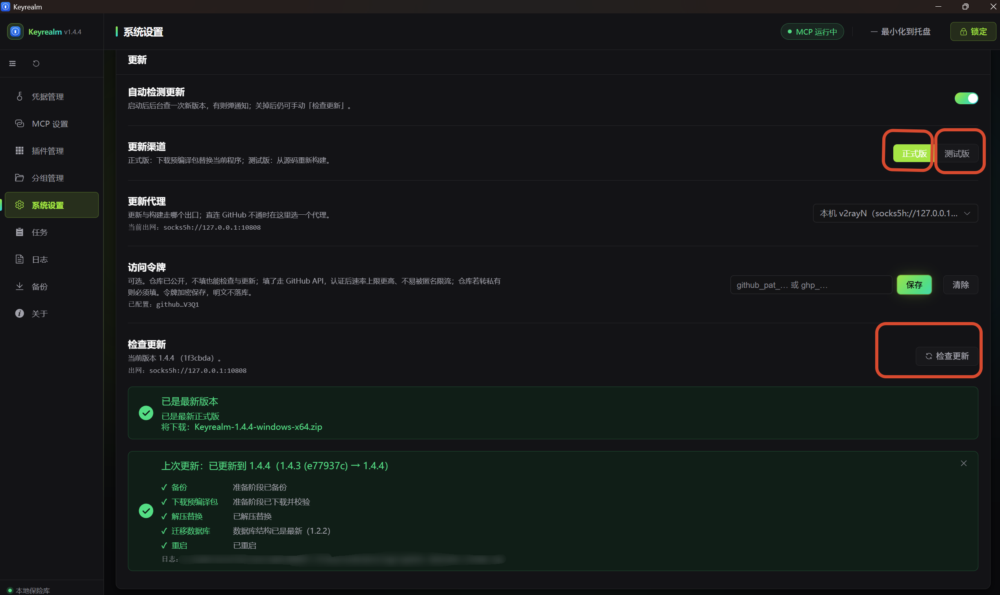

# 凭域 Keyrealm 


致力于 **ALL IN ONE** 的本地凭据管理与验证平台。 允许将红队渗透测试中获取的散落在各处的 API Key、云厂商 AK/SK、机器人 Token、邮箱授权码、登录态等集中加密保管、便捷验证与快速利用。

数据只存在自己本地机器的程序目录里，不联网同步、不上传云端。

---

## 功能

### 加密存储

- **AES-256-GCM** 字段级加密，密钥由主密码经 **PBKDF2-HMAC-SHA256** 派生，仅存内存。
- 敏感字段与非敏感字段分列存放：列表展示不必解密，同时保证密钥类字段全程不落明文。
- 主密码没有**任何**找回途径（无后门、无恢复码）——详见[安全说明](#安全说明)。

### 主动验证

- **单条 / 批量 / 定时**三种方式。批量验证并发数与请求超时可在对话框里就地调整。
- 定时计划的验证范围可选多种范围，更加自由。
- 校验结果不只是「有效 / 无效」，更有针对专一凭据的特殊标注。
- 有写副作用或咱无法自动化的类型（如 DuckDNS、Telegram api_id/hash、短信网关）标记为不参与批量验证，只允许手动逐条验证，避免把人工判定的结果刷掉。

### 插件化

- 一个服务一个插件，现目前共有 **65 个插件、10 个类别**（见[支持的服务](#支持的服务)）。
- 插件放在程序目录的 `plugins/` 下，**放入即加载、删除即卸载**，无需安装器；临时停用无需删目录，在界面里禁用即可（状态记在 `plugins/.state.json`）。
- 禁用**不动磁盘目录**：名下凭据照常显示、可编辑、可导出，只是「操作」「验证」置灰、批量验证自动跳过，禁用≠删除，快速找回插件。

### 凭据操作

部分插件在验证之外还提供操作，随凭据行出现「操作」按钮：

- **对话**：对 LLM 凭据直接发一次简单对话（流式返回）。
- **表单**：带写副作用的操作（如修改 DNS 解析记录、刷新令牌），提交前二次确认。
- **列表**：可下钻的查询，如「云主机实例」「对象存储桶 → 对象浏览」「域名列表 → 解析记录」。

没权限的操作会自动隐藏（插件探测该凭据的真实权限），一个都没有时给出说明。

### 代理

- 可维护**多个代理**，设一个全局默认；**每条凭据**可三选一：跟随上层设置 / 指定某个代理 / 直连。解析优先级为 `本条凭据 > 该插件预设 > 所属类别预设 > 全局默认`。
- 代理支持 `http` / `https` / `socks4` / `socks5` / `socks5h`。
- 任一代理可一键**对照测试**：同一批探测分别走直连与代理，比对出口 IP 归属与国内外站点可达性，直接给出「代理是否真的生效」的结论。
- 邮箱（SMTP / IMAP）走裸 TCP，不使用 HTTP 代理，会自动改用 SOCKS / HTTP CONNECT 隧道穿出去。

### 备份与恢复

- 导出为单个 JSON 文件：**加密导出**（保留密文）或**明文导出**（可跨主密码导入）。

- 可选「**全部**（凭据 + 分组 + 代理 + 预设 + 定时计划 + 设置 + 保险库 KDF + MCP + 插件启停）」或「仅选中的凭据」。整库档自带盐（salt），文件自包含。

- 导入是**填充式**的：以当前库为蓝本，把备份条目填进去，不删也不覆盖既有数据。
  
  插件不存在或被禁用、含当前插件不认识的字段、缺少必填字段的条目会整条判失败、不写库，并逐条列出原因；
  
  每次导入在 `data/logs/` 下留一份完整导入日志与（有失败时）一份失败日志，结果弹窗里可一键打开便于人工补录。
  
- 换保险库也能还原：在另一台机器 / 新装的 Keyrealm 上导入整库备份时，会再问一次它当时的主密码，并用它 + 文档里的盐派生源密钥解开密文，再以当前库的密钥重新加密写回（当前库自己的盐/校验值不受影响）。

### 其它

- **凭据简易操作、分组管理、6 套界面主题**（3 浅 3 深）、侧边栏与凭据目录树顺序均可拖拽调整。
- **后台任务**：下载 / 打包这类长操作登记为任务，可看进度、可取消，关掉弹窗照常跑；任务记录持久化到 `data/tasks.json`，重启后历史仍在（上次没跑完的标为「已中断」）。
- **独立日志页**：级别可调、支持关键词搜索（含 traceback 的整条记录匹配）。
- **单实例**：重复启动不会开出第二个窗口，而是把已运行的拉到前台。
- **开机自启动**（默认关闭）。
- **跨平台**：Windows 优先，兼容 macOS 与 Linux。

---

## 效果演示


## 支持的服务

| 类别 | 数量 | 服务 |
|---|---:|---|
| LLM 模型 | 19 | OpenAI（含 Codex / ChatGPT 登录态）、Anthropic、Gemini、DeepSeek、Moonshot、智谱 GLM、阿里百炼、火山方舟、文心、MiniMax、NVIDIA、OpenRouter、硅基流动、华为云 MaaS、商汤日日新、小米 MiMo、CodeBuddy、OpenAI 兼容、New API |
| API 服务 | 8 | Firecrawl、Tavily、秘塔 AI 搜索、Coze（扣子）、Dify、FOFA、Google API、百度人脸 |
| 即时通讯 | 10 | 飞书、钉钉、企业微信、Telegram（Bot / api_id+hash）、Discord、QQ 频道机器人、微信 iLink Bot、微信公众号、微信小程序 |
| 云服务商 | 12 | 阿里云、腾讯云、AWS、GCP、华为云、Firebase、京东云、UCloud、百度智能云、火山引擎、天翼云、Cloudflare |
| 对象存储 | 2 | S3 兼容对象存储（MinIO / Ceph 等自建）、匿名对象存储（公开桶检测：匿名列举/读取/写探测） |
| 域名解析 | 3 | DNSPod、DuckDNS、GoDaddy |
| 开发者平台 | 4 | GitHub、Hugging Face、Weights & Biases、npm |
| 地图 | 3 | 高德地图、百度地图、腾讯地图（腾讯位置服务） |
| 交易所 | 2 | OKX、Binance |
| 邮箱 / 短信 | 2 | 通用 SMTP（覆盖 Gmail / QQ / 163 / 126 等）、短信 / 接码网关 |

---

## 下载与安装

### 通过预编译程序运行

#### Windows

从 [Releases](../../releases) 下载对应平台与架构的压缩包，解压后直接运行，双击运行  `Keyrealm.exe` 即可。

PS：需要 **WebView2 Runtime**（Windows 10/11 通常已内置；若启动时报缺 WebView2，从微软官网安装即可）。


#### MacOS

从 [Releases](../../releases) 下载对应平台与架构的压缩包，解压后运行包内的 `Keyrealm` 文件。

PS：由于未签名，首次打开会被 Gatekeeper 拦，需要右键→「打开」，或终端执行 `xattr -dr com.apple.quarantine Keyrealm` 放行。


#### Linux

从 [Releases](../../releases) 下载压缩包，解压后运行包内的 `Keyrealm`，免安装。

由于 Linux 生态的多样性，将预先给出**两种包**，请根据自身情况选择：

| 包                                            | 界面后端                    | 适合的系统                                                   |
| --------------------------------------------- | --------------------------- | ------------------------------------------------------------ |
| `Keyrealm-<版本>-linux-general-<架构>.zip`    | **Qt**（PySide6 自包含）    | **任意发行版**，基线 **glibc ≥ 2.35**（Ubuntu 22.04 / Debian 12 / Fedora 36 及更新）。通用兜底、体积大 |
| `Keyrealm-<版本>-linux-gtk-<系统>-<架构>.zip` | **GTK**（用系统 WebKitGTK） | **仅限构建它的那个发行版**（如 `ubuntu22.04`）。体积小、不依赖 GL |

对于 Linux 系统，我们更推荐自行构建源码运行，以适应各自高度个性化的系统，


### 通过源码运行

基础环境要求：

| 依赖    | 版本  | 说明           |
| ------- | ----- | -------------- |
| Python  | 3.11+ | 后端与打包     |
| Node.js | 18+   | 仅用于构建前端 |

如果需要从源码运行，请参考以下流程：

```shell
git clone https://github.com/YZBRH/keyrealm.git
cd keyrealm

python -m venv .venv
.venv/bin/pip install -r requirements.txt

.venv/bin/python main.py
```

如果你想要把他编译成二进制文件，参考追加执行命令：

```shell
.venv/bin/pip install pyinstaller
.venv/bin/python scripts/build.py --frontend
```


如果你是在 Linux 系统上运行的，还需要指定界面后端，它们之间的区别如下：

|              | **Qt**（默认）                                | **GTK**                                                      |
| ------------ | --------------------------------------------- | ------------------------------------------------------------ |
| 装什么       | `pip install "pywebview[pyside6]"`            | 按发行版装系统包（见下）                                     |
| 体积（实测） | 下载 ≈ 253 MB / 装完 ≈ **677 MB**             | 系统侧 ≈ **105 MB**，venv 侧 ≈ 0                             |
| **打包分发** | **自包含**——PyInstaller 把 PySide6 整包收进去 | **可打包**——打成"专项档"（收进系统 gi/WebKit），见 [docs/LINUX_GTK_MATRIX.md](docs/LINUX_GTK_MATRIX.md) |
| 适合         | 打包分发、给谁都能跑                          | 本机跑源码；或只在**同款机器**上分发                         |


```shell
# 源码运行
python main.py                       # Linux 默认：有 Qt 用 Qt，没有则退回 GTK
KEYREALM_GUI=gtk python main.py      # 指定走系统 GTK

# 打包
python scripts/build.py --frontend               # 默认打成 Qt 版
python scripts/build.py --frontend --gui gtk     # 打成 GTK 版
```

详见 [CONTRIBUTING.md](CONTRIBUTING.md)。


---

## 程序更新

### 软件内更新



根据软件内选项选择即可。

将更新渠道设置为"正式版"时，将从 [Releases](../../releases) 中拉取对应架构的最新版本；

将更新渠道设置为"测试版"时，将从仓库当中拉取最新的 commit 并进行源码编译成最新的二进制文件。


如果是从 [Releases](../../releases) 中下载的预编译包运行的，我们推荐后续的所有更新都通过"正式版"方式更新。


如果 [Releases](../../releases) 中没有对应的预编译包，通过"正式版"渠道更新可能会出问题，欢迎提交 Issue 或 PR 来说明需要支持的更多操作系统版本。


### 软件外更新

如果你通过预编译程序运行的，请优先考虑通过软件内更新。


对于源码运行，只需要拉取最新 commit 提交，然后运行数据库迁移脚本即可（如果有），示例：

```shell
cd keyrealm
git pull

# 如果数据库结构版本有改动，运行对应的一跳迁移脚本（脚本默认只演练，加 --apply 才写库；
# 跑之前请先完全退出应用）
python scripts/migrations/m_1.2.1__to_1.2.2.py --apply

python main.py
```


---

## 快速上手

1. **设置主密码。** 首次启动要求设置主密码——它用于派生加密密钥。
   
   **忘记即无法恢复**，请自行妥善保存。
   
2. **添加凭据。** 在左侧「凭据目录」选一个服务 → 点「添加凭据」→ 按表单填写。
   表单字段由插件声明（如 API Key、Base URL、备注），敏感字段保存前即加密。
   也可以先给某个**类别或插件**设好默认值（Base URL、备注、走哪个代理），新建时自动带出。

3. **验证。** 保存后默认自动验证一次；之后可随时点行内「验证」，或用工具栏的「批量验证」
   勾选多条一起验，或在「任务」页配置定时验证计划。

4. **看结果。** 列表里的「状态」列给出结论，「附加信息」列给出余额 / 使用率 / 账号信息；
   有些凭据行还会出现「操作」按钮，可做验证之外的查询与操作。

---

## MCP支持

Keyrealm 内置一个 **MCP Server**，Agent 可以直接查询、创建、验证凭据，不必把密钥复制到聊天上下文里。

1. 在「设置 → MCP 服务」页手动启动服务（默认监听 `127.0.0.1:8765`，仅本机）。在端口被占用时将会直接报错而不自动换端口。
2. 页面提供现成的客户端配置 JSON 与访问 Token（Bearer）。把配置粘进 Claude Desktop / Cursor / Claude Code 等客户端即可。
3. **工具权限默认关闭**，需要在同一页逐个开启。共 20 个工具：读类默认开，写与高危类默认关（开启前二次确认）。
4. Token 明文**只在轮换时展示一次**，数据库只存哈希与前缀，鉴权失败将返回 401。

完整接口规范见 [MCP 接口规范](docs/MCP_API.md)。

---

## 安全说明

| 项目 | 做法 |
|---|---|
| 加密算法 | AES-256-GCM（字段级，带认证） |
| 密钥派生 | PBKDF2-HMAC-SHA256，10 万次迭代，随机 16 字节 salt |
| 密钥存放 | 派生密钥只存在内存，锁定时立即清除 |
| 数据位置 | 程序目录下的 `data/`，不联网同步、不上传任何第三方 |
| 网络行为 | 仅「验证 / 操作」时按你的配置发起请求；MCP Server 默认不启动、仅监听本机 |
| 输出净化 | 插件的返回文本与日志会过滤掉回显的敏感字段值 |
| 空闲锁定 | 可选：一段时间无操作后自动清除内存密钥 |

主密码无法找回。加密密钥由主密码派生，没有任何后门或恢复码——丢了主密码就丢了解密能力。

建议定期用「备份」页导出（记得用同一个主密码，或选择明文导出自担风险）。

---

## 常见问题

**Q：忘记主密码了怎么办？**
无法恢复。只能删掉 `data/` 目录重新开始（已加密的数据无法解密）。

**Q：数据存在哪里？怎么整机迁移？**
程序的 `data/` 目录：`credentials.db`（凭据库）、`logs/`（日志）、`tasks.json`（任务记录）、`webview/`（界面偏好）。整机迁移直接拷 `data/` 即可（主密码随之带走）。也可以只用「备份」页导出 JSON 迁移，粒度更细。

**Q：升级会不会丢数据 / 重置我的插件启用状态？**
不会。升级只替换程序与 `plugins/`，`data/` 原样保留，`plugins/.state.json`（启用 / 禁用状态）也不会被覆盖。

**Q：怎么更新到新版本？**
两种渠道，在「设置 → 更新」里选：
- **正式版**：从 GitHub Release 下载对应平台的预编译包替换当前程序（不编译），更新前会把可执行文件、
  `plugins/`、`data/` 备份到 `data/backup/`（只留最近一份），数据库结构有变动会逐级自动迁移。
- **测试版**：跟 `main` 最新提交从源码重新构建（本机没有源码会先拉一份到程序目录），如果本机缺少开发环境，运行可能会报错，建议优先选择正式版。

两种更新前都会自动备份；准备完成后会询问是否立即重启，选「稍后」则保留已下载的包 / 已构建的产物，下次更新直接复用、不重复下载或构建。默认开启「自动检测更新」——每次程序启动后会自动查一次，发现新版本弹通知提醒；也可以随时在「设置 → 更新」手动检查。

为了保障数据安全，我们仍建议在自动更新前，再进行一次手动导出备份。

也可以手动从 [Releases](../../releases) 下载压缩包。
详见 [程序内更新](docs/UPDATE.md)。

**Q：某个服务验证失败或有超时，是不是我的 Key 坏了？**
先看是不是网络问题。部分厂商（Telegram、Discord、Hugging Face 等）在国内需要代理才能访问，请在「设置 → 网络与代理」里配好代理，再对该凭据指定出口。

**Q：MCP 服务启动失败？**
多半是端口被占用。到「设置 → MCP 服务」改一个端口再启动（应用不会自动换端口）。

**Q：日志在哪里？**
`data/logs/keyrealm.log`（1 MB × 5 轮转），也可以在「日志」页里直接查看与搜索。

**Q：验证会不会产生费用或副作用？**
校验一律使用**只读**接口，不会修改你在厂商侧的任何配置。唯一的例外是插件显式提供、由你**手动点击**的操作（如修改 DNS 记录、刷新登录态令牌）；另有「欠费探测」会额外发一次极小的对话请求（默认关闭，开启时会消耗极少量额度）。

---

## 文档

| 文档 | 内容 |
|---|---|
| [架构设计](docs/ARCHITECTURE.md) | 模块划分、数据流、线程模型、日志与配置 |
| [前端设计](docs/FRONTEND.md) | 页面结构、交互细节、主题与样式层 |
| [插件开发指南](docs/PLUGIN_GUIDE.md) | 插件结构、`manifest.json`、`plugin.py` 接口、插件清单 |
| [签名器校准证据](docs/SIGNER_CALIBRATION.md) | 五家云厂商签名算法的逐字源码依据（含版本 / commit）与重新校准步骤 |
| [MCP 接口规范](docs/MCP_API.md) | 连接方式、鉴权、全部工具与参数 |
| [数据库设计](docs/DATABASE.md) | 表结构、ER 图、迁移策略 |
| [程序内更新](docs/UPDATE.md) | 两种更新档、应用内 / 命令行更新、备份与回滚、数据库逐级迁移 |
| [更新日志](CHANGELOG.md) | 各版本变更 |

---

## 开发与贡献

构建、打包、插件开发与提交约定见 **[CONTRIBUTING.md](CONTRIBUTING.md)**。

发现问题或想加新插件服务，欢迎提 Issue / PR。

---

## 声明

**本工具仅限合法用途。** 仅可用于你本人拥有、或已从所有者处取得**明确书面授权**的系统与凭据；禁止用于任何未授权目标、账号或系统。

- **凭据来源自负其责**：你对导入本工具的全部凭据之来源合法性与使用权限负全责；作者不参与、不追认、不背书任何凭据的获取行为。
- **联网与第三方条款**：验证 / 操作会以你的凭据向对应厂商发起**真实请求**，可能消耗额度、触发风控或违反该厂商服务条款；部分「操作」带**写副作用**（改 DNS 记录、刷令牌、改写对象存储）；「匿名对象存储」插件会对目标桶发起**匿名列举 / 读取 / 写探测**，仅可用于已获授权目标。使用本工具进行相关操作时视为你已经知晓并同意承担相应风险。
- **数据与暴露面**：主密码**无找回途径**，遗失即永久失去数据；「明文导出」文件含**全部凭据明文**；「MCP 服务」一旦启用，本机任何能访问该端口的程序（含 AI Agent）均可读取整库凭据——均请自行评估并设防。

继续使用即表示你已理解并接受上述条款，以及 [MIT 许可](LICENSE) 的相关条款内容。

---

### 第三方商标

本项目分发的插件图标为**第三方商标图形**，取自各厂商官网、官方品牌资源包、App Store 官方图标与 [Simple Icons](https://simpleicons.org/)（CC0-1.0）、Iconify 的 `thesvg` 集合（MIT）等公开来源，仅用于**标识对应的服务**。

商标归各自权利人所有，本项目与这些厂商**无隶属或背书关系**。

图标的逐个来源与选取标准见 [插件开发指南](docs/PLUGIN_GUIDE.md) 的 logo 小节。